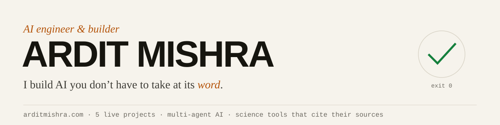
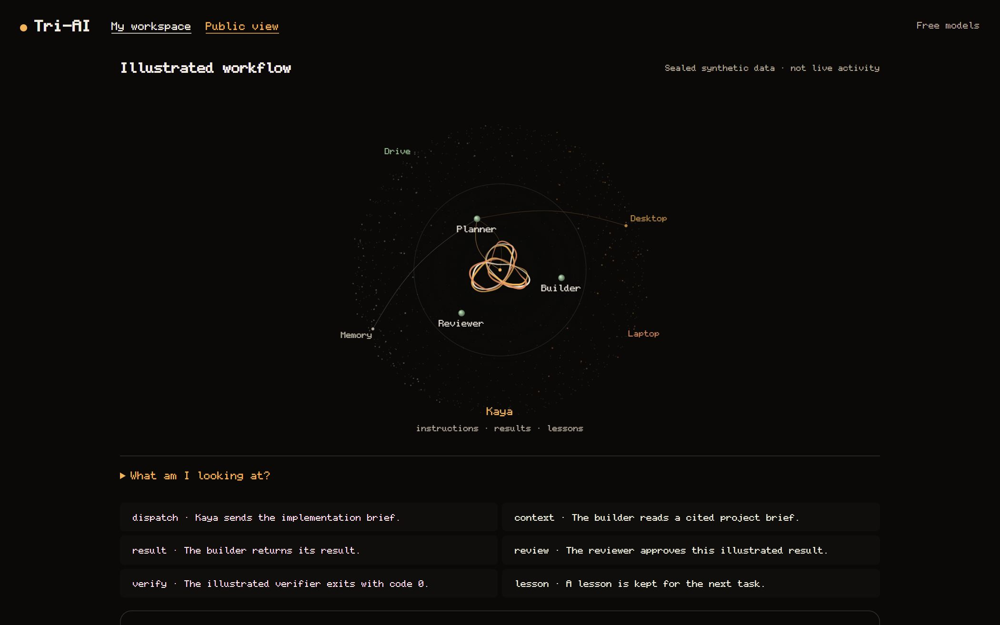
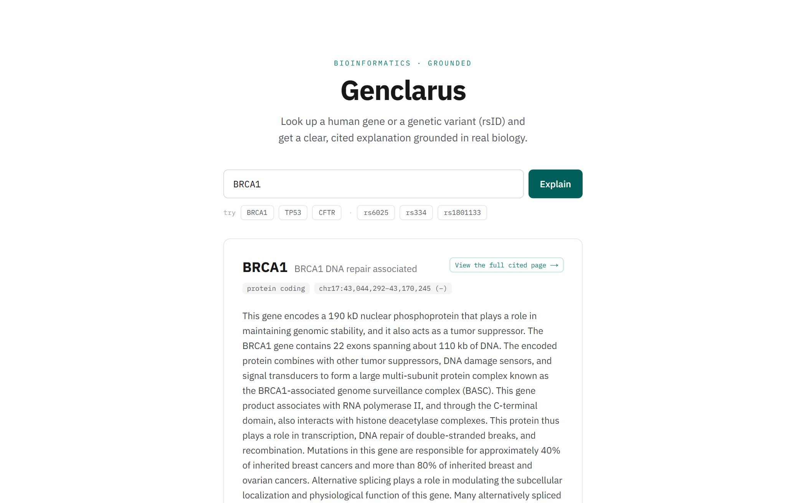
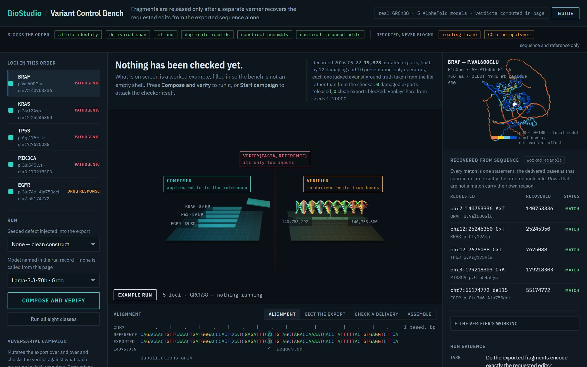
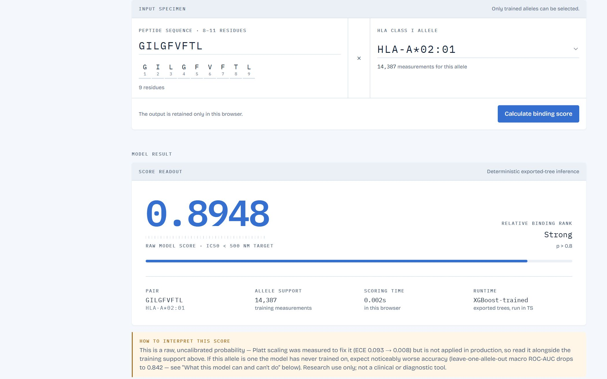
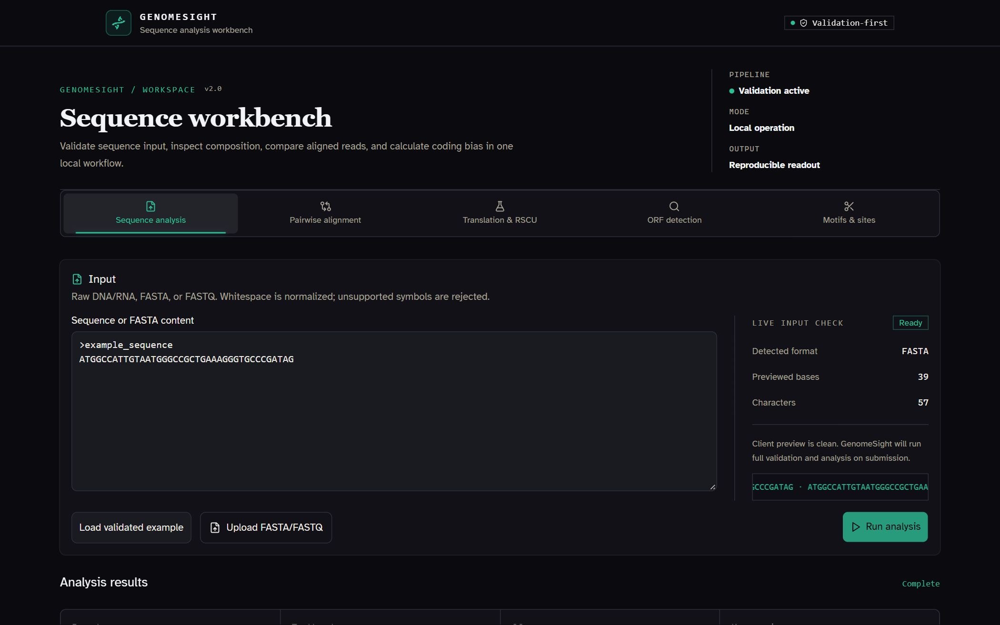

<a href="https://arditmishra.com">
  <picture>
    <source media="(prefers-color-scheme: dark)" srcset="assets/banner-dark.svg">
    
  </picture>
</a>

  
  
  
  

Science taught me evidence. Trading taught me risk. Running a business's data taught me what actually moves it.
Now I build AI systems, and science tools, that prove what they claim.

## What I've built

<table>
<tr>
<td width="50%" valign="top">

<h3><a href="https://github.com/Ardit-Mishra/tri-ai">Tri-AI</a></h3>
<b>A general contractor for software.</b> Text it a job on Telegram; free AI models build each step, a reviewer approves it, and a real test decides if it counts. A build costs $0. 
Python · LLM agents · SQLite · Ollama · Telegram
</td>
<td width="50%" valign="top">

<h3><a href="https://github.com/Ardit-Mishra/genclarus">Genclarus</a></h3>
<b>A translator with footnotes for your genes.</b> Plain-English explanations where every sentence cites the database field it came from. No model writes the facts. 
Next.js · TypeScript · BM25 + embeddings · Vitest
</td>
</tr>
<tr>
<td width="50%" valign="top">

<h3><a href="https://github.com/Ardit-Mishra/biostudio">BioStudio</a></h3>
<b>A second proof-reader for DNA orders.</b> Re-derives every edit from the final sequence and the reference genome alone. 19,823 attempts to fool it, 0 got through. 
Python · FastAPI · React · Three.js · Docker
</td>
<td width="50%" valign="top">

<h3><a href="https://github.com/Ardit-Mishra/peptide-mhc-binding-predictor">Peptide–MHC</a></h3>
<b>A lock-and-key test for the immune system.</b> Runs in your browser. 15 models compared on one leak-free split; the simplest won at 0.919 ROC-AUC. 
XGBoost · PyTorch · ESM-2 · TypeScript
</td>
</tr>
<tr>
<td width="50%" valign="top">

<h3><a href="https://github.com/Ardit-Mishra/genomesight">GenomeSight</a></h3>
<b>A calculator for DNA.</b> ORFs, motifs, codon usage and alignment. Same input, same answer, every time; Cython makes it up to 11× faster. 
Python · FastAPI · Cython · React
</td>
<td width="50%" valign="top">
<h3><a href="https://github.com/Ardit-Mishra/Multiple-Sclerosis-RNA-Seq">MS RNA-seq</a></h3>
<b>Where it started.</b> A four-person Loyola project: does Sephin1 change gene activity in a mouse model of multiple sclerosis? Raw reads to pathways. 
Kallisto · Sleuth · R · Snakemake
</td>
</tr>
</table>

## Skills, with receipts

| Skill | Where it shows |
|---|---|
| **Agentic AI & multi-agent systems** | Tri-AI: planner, builder and reviewer agents; stuck-agent detection; failed work reverts itself |
| **LLM evaluation & guardrails** | Called all 574 models a router listed; 20 answered as themselves. Work counts only when a test exits 0 |
| **RAG & grounded answers** | Genclarus: hybrid BM25 + local embeddings, Recall@10 0.950; refuses any sentence it cannot cite |
| **AI-assisted development** | Claude Code and Codex daily: one AI writes, a second reviews, the test suite decides, I check the claims |
| **Machine learning** | Leak-free splits, honest baselines, browser inference matching the trained model to 7.5e-08 |
| **Python, APIs & testing** | FastAPI, Cython, SQL; pytest, Vitest, GitHub Actions; ~2,500 tests gate Tri-AI deploys |
| **Bioinformatics** | GRCh38, ClinVar, gnomAD, UniProt, Biopython, Kallisto, Sleuth |

## How I work

Every project publishes what was tried and **did not** ship next to what did (see the `DECISIONS.md` files). When an earlier version claimed more than it measured, the fix is documented too.
